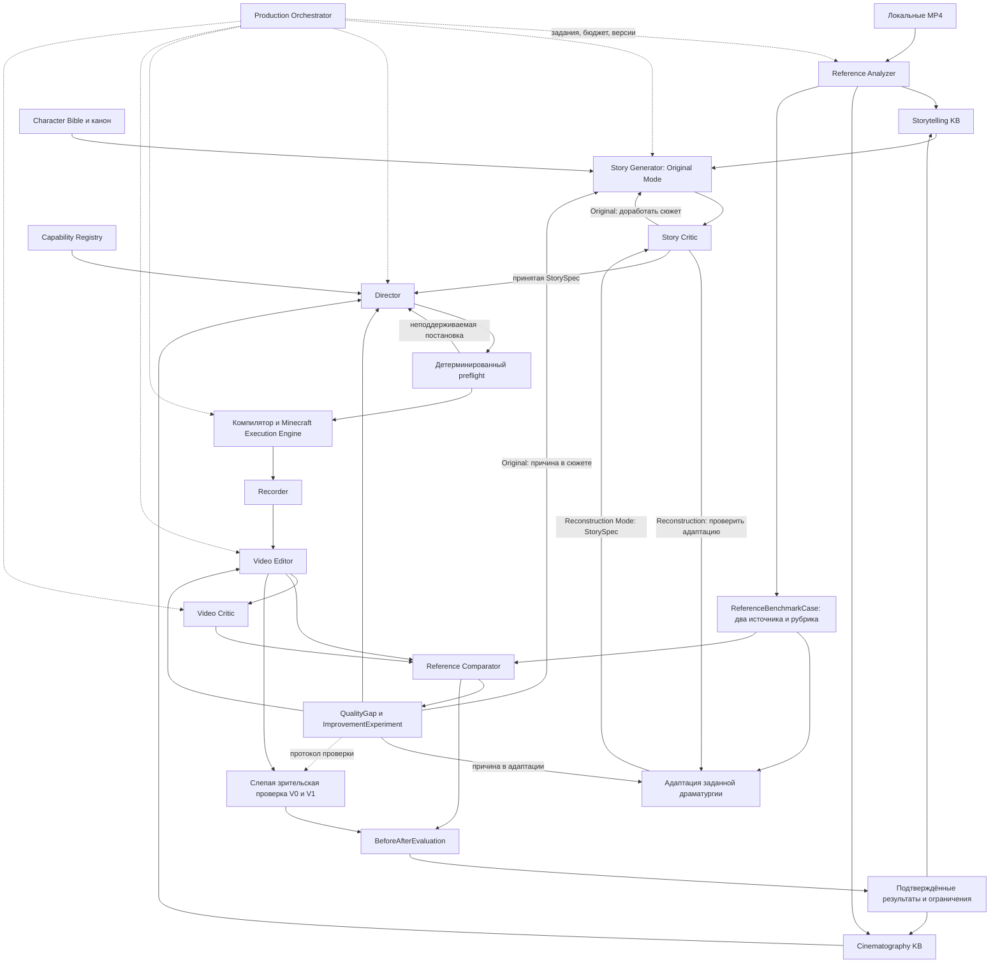

# Minecraft AI Film Studio — предлагаемая архитектура

Дата: 26 октября 2026. Статус: проектное предложение. Численные пороги и организационные решения ниже — предлагаемые условия MVP, а не результаты уже выполненных испытаний.

**Главный подход: Reference-Driven Iterative Film Production.** Анализ сильных референсов → структура, причинность, эмоции, камера, монтаж и темп → технически реализуемая постановка → фильм в Minecraft → сравнение с релевантными эталонами → конкретные QualityGap → исправление → повторное сравнение и зрители → подтверждённые знания об успехах и неудачах. Референс остаётся в цикле после генерации; он не сводится к источнику карточек KB.

Главный вопрос MVP: **можем ли мы систематически улучшать качество собственного Minecraft-фильма, сравнивая его с сильным референсом, а не только генерировать и оценивать ролики?** Первый проверяемый шаг — законченная история **30–60 секунд**, два референса и доказуемое локальное улучшение. Полный автономный конвейер и оригинальные 60–120 секунд — следующий этап. Дообучения весов моделей в MVP нет.

## 1. Критическая оценка реализуемости

**Короткий управляемый пилот технически реалистичен. Автоматическое производство стабильно интересных эпизодов на 10–15 минут пока следует считать исследовательской целью.** Старый проект существенно снижает риск базового запуска и записи, но не снимает риски режиссуры, выразительности, взаимодействий и оценки истории. [Аудит и границы свидетельств](LEGACY_AUDIT.md).

| Часть задачи | Оценка для MVP | Почему |
|---|---|---|
| Приём MP4, извлечение кадров, монтаж, хранение, очереди | Обычная инженерия | Детерминированные операции, проверяемые входы/выходы |
| Структурированное описание видимых событий | Реализуемо с ошибками | OpenAI vision по последовательностям кадров; требуется привязка к свидетельствам |
| Адаптация заданной драматургии на 30–60 секунд | Первый исследовательский MVP | Позволяет отдельно испытывать постановку и исполнение; изменения структуры документируются |
| Оригинальный связный сюжет на 60–120 секунд | После сравнительного пилота | Генерация кандидатов, причинный граф и сравнительная проверка с эталонами |
| Читаемая постановка с ограниченным набором действий | Реализуемо после технической проверки | Конечная библиотека исполнения и независимая проверка каждого ключевого действия |
| Произвольная анимация, физический контакт, акробатика | Высокий риск | Нужны риг, контактные ограничения, специальные primitives; LLM этого не заменяет |
| Объективная автоматическая оценка интересности | Недостижимо как гарантия | Только диагностический сигнал, калиброванный на зрителях |
| Измеримое улучшение после сравнительной диагностики | Главная проверка первого MVP | Зафиксированные benchmark, baseline и гипотеза; новая версия и слепая зрительская проверка |
| Полный цикл без вмешательства на поддерживаемом материале | Последующий этап автоматизации | Не является условием первого сравнительного эксперимента |
| Извлечение готовых Minecraft-анимаций из чужого видео | Не входит в MVP | По картинке не восстанавливаются надёжно скрытые позы, 3D, исходный риг и команды |

Главный результат первого этапа — законченная понятная история и подтверждённое улучшение хотя бы одного существенного недостатка относительно её исходной версии и фиксированного референсного benchmark. Наличие модулей, JSON, MP4 или выросших AI-баллов само по себе не означает успех.

### Два режима производства

| Режим | Источник драматургии | Для чего сравниваем | Ограничения |
|---|---|---|---|
| **Reference Reconstruction Mode** (`reference_reconstruction`) | Выбранная сюжетная структура Alan Becker адаптируется под Minecraft; фиксируются сохранённые причины/следствия и все изменения | Отдельно проверить передачу заданного смысла режиссурой и исполнением; Ethobot задаёт релевантные постановочные ориентиры | Внутреннее исследование, собственные/нейтральные актёры; артефакты реконструкции и детальные заимствованные последовательности не публикуются как оригинальный фильм |
| **Original Generation Mode** (`original_generation`) | Оригинальная StorySpec с библиотекой общих приёмов | Сопоставить функционально похожие моменты с внешними эталонами и принятыми собственными фильмами | Не переносить уникальных персонажей, защищённые элементы и конкретные сюжетные последовательности в публичный оригинальный выпуск |

Mode фиксируется до производства и входит во все сравнительные артефакты. Его нельзя сменить у реконструкции на original без новой StorySpec и проверки оригинальности. Два режима производства независимы от `staged_visual/server_action`, которые описывают способ исполнения действий.

Реконструкция не делает драматургию безошибочной: адаптация может потерять нужную предпосылку или изменить причинность. Это отдельная гипотеза, проверяемая сравнением исходного skeleton, AdaptationRecord и снятого результата.

### Условия «настоящего Minecraft»

Финальные визуальные планы рендерятся графическим клиентом Minecraft Java в игровом мире. Мир, материалы и персонажи сохраняют узнаваемый Minecraft-вид. Моды используются для постановки, камеры, актёров и записи; финальные кадры не дорисовываются text-to-video. Монтаж и наложение звука выполняются вне игры.

Возможны два режима действий, и их нельзя смешивать в отчёте:

- `staged_visual`: актёр или предмет рисуется и анимируется внутри Minecraft, но не является полноценным участником игровой физики.
- `server_action`: изменение действительно выполняется в Minecraft-мире — блок, дверь, инвентарь, состояние сущности — и подтверждается сервером.

Первый режим соответствует съёмке в игре, но не доказывает автономное прохождение игры. Для первого MVP серверные события нужны только там, где их требует выбранный смысловой benchmark; иначе достаточно статичного мира и постановочной анимации. Если нужное событие недоступно, до baseline freeze выбирается эквивалентная адаптация с сохранением функции либо другой case. После freeze смысловая замена создаёт новую версию адаптации/эксперимент и не маскируется под чистую правку камеры.

## 2. Архитектурные границы

12 модулей с Reference Comparator — логические границы, **не 12 сервисов и не обязательные автономные агенты**. Это целевая архитектура. Для первого эксперимента нужны только выбранные фрагменты референсов, принятая адаптация, подробный план, минимальный путь съёмки/монтажа, Comparator и журнал before/after. Ручная постановка/запуск допускаются с ManualInterventionRecord. Полные Story Generator, оркестратор, автоматический repair и большие KB откладываются до проверки цикла; для хранения достаточно локальных файлов.

### Входы и выходы всех обязательных модулей

| Модуль | Вход | Выход | Метод и ответственность |
|---|---|---|---|
| 1. Reference Analyzer | ReferenceAsset, AnalysisPolicy | ReferenceAnalysis: ShotObservation, ActionObservation, AudioEvent, TechniqueCandidate | Медиаоперации кодом; смысловая интерпретация OpenAI; фиксирует, что не наблюдалось |
| 2. Storytelling Knowledge Base | Подтверждённые TechniqueCard типа story, запрос поиска | Версионированный TechniqueBundle с источниками | Дедупликация, отбор, поиск, контрпримеры; не генерирует эпизод |
| 3. Cinematography Knowledge Base | TechniqueCard типа staging/camera/editing/sound, CapabilityProfile | TechniqueBundle с условиями исполнения | Хранит замысел приёма отдельно от привязки к движку |
| 4. Story Generator / адаптация | ProductionMode, EpisodeBrief, CharacterBible, TechniqueBundle либо ReferenceBenchmarkCase, ограничения | StorySpec; в Reconstruction Mode также AdaptationRecord | В первом опыте принятая адаптация может быть ручной; генерация оригинальных кандидатов подключается позже; без BBS-команд |
| 5. Story Critic | StorySpec, brief, канон, рубрика | StoryReview: дефекты, ссылки на beats, pass/revise/reject | Проверяет мотивацию, причинность, подготовку развязки; код валидирует граф и ограничения |
| 6. Director | Принятая StorySpec, CinematographyBundle, CharacterBible, CapabilityProfile, LocationSpec | DirectionPlan: SceneSpec, PerformancePlan, ShotSpec, EditPlan, SoundPlan | Решает, что зритель должен понять и как это показать; не пишет произвольный код |
| 7. Minecraft Execution Engine | PreflightReport=pass, CompiledTake, WorldSnapshot | ExecutionTrace, AppliedEvent, достигнутое состояние | Детерминированный адаптер: движение, позы, камера, ограниченные изменения мира |
| 8. Recorder | RenderRequest, готовый engine, RenderProfile | TakeManifest, video-only take, TechnicalQC | Захват кадров и связь кадров с production time; результат не означает художественную приёмку |
| 9. Video Editor | EditPlan, SoundPlan, принятые TakeManifest, каталог звука | MasterVideo, EditManifest, AudioMixReport | Точные склейки, звук, нормализация, экспорт через FFmpeg |
| 10. Video Critic | MasterVideo, EditManifest, рубрика; затем StorySpec/DirectionPlan для проверки | VideoReview, FilmAnalysis, Defect | Слепое восстановление увиденного и техническая/внутренняя проверка; не подменяет сравнение с эталоном |
| 11. Production Orchestrator | ProductionRequest, BudgetGrant, версии артефактов, эксперимент | ProductionManifest, задания, CostLedger, журнал вмешательств | Позже автоматизирует зависимости и retry; в первом опыте достаточно ручного manifest и лимитов |
| 12. Reference Comparator | Замороженный ReferenceBenchmarkCase, независимые анализы референсов и фильма, NarrativeBeatAlignment, capability/adaptation context | ReferenceComparisonReport и QualityGap; после исправления новый отчёт | Сравнивает смысловые функции по девяти измерениям, указывает evidence и границы сравнимости; не исполняет исправление и не объявляет гипотезу подтверждённой |

Полные поля, единицы и инварианты: [DATA_CONTRACTS.md](DATA_CONTRACTS.md). Дополнительные сущности — служебные части этих модулей, не новые обязательные микросервисы.

### Технологический минимум

- Python: orchestration, медиаподготовка, JSON-валидация, OpenAI SDK, отчёты.
- Java/Fabric: адаптер игрового потока, BBS-компиляция, состояние мира и захват.
- SQLite с FTS и обычные JSON-артефакты: библиотека и журналы. Векторная БД для первых десятков приёмов не нужна; embeddings OpenAI — возможное позднее расширение.
- FFmpeg/ffprobe: decode, прокси, сборка и технический контроль; PySceneDetect — кандидат для обнаружения смен планов. Его детекторы не понимают драматические сцены. [Документация PySceneDetect](https://www.scenedetect.com/docs/latest/), [фильтры FFmpeg](https://ffmpeg.org/ffmpeg-filters.html).
- Локальная очередь с атомарными файлами между приложением и worker; один активный render на игровой клиент. Никакой необходимости в Kubernetes, распределённой БД или облачном GPU на старте.

## 3. Сценарий, режиссура и исполнение — три разных языка

### Сценарный уровень: зачем происходит событие

StorySpec описывает цель, препятствие, попытку, последствие, новую информацию и изменение отношений. У каждого существенного beat есть причинные зависимости. Развязка использует ранее показанный факт, навык или выбор персонажа. Сцена не принимается, если она только заполняет время.

До режиссуры Story Critic проверяет:

1. Можно ли понять цель по наблюдаемому действию без титров, реплик и знания референса?
2. Создаёт ли попытка следующий конфликт, а не просто сменяется другим событием?
3. Меняет ли хотя бы одна ошибка план персонажа?
4. Подготовлен ли финальный ход и можно ли показать его доступными средствами?
5. Есть ли эмоциональный результат, отличный от «они закончили двигаться»?
6. Различаются ли реакции персонажей по характеру?

В Original Generation Mode драматическая схема — ориентир, а не требование одинаковых поворотов в каждом ролике. Позднее генератор создаёт три логлайна; подробно разрабатывается только выбранный. Первый Reconstruction-пилот использует заданную структуру и не требует конкурса оригинальных сюжетов.

### Режиссёрский уровень: что увидит и поймёт зритель

Для каждого beat Director обязан задать:

- `audience_inference`: проверяемое утверждение о понимании зрителя;
- цель и изменение эмоции каждого активного персонажа;
- конкретную последовательность действий и выразительные паузы;
- блокинг: позиции, направление взгляда, объект внимания и дистанции;
- главный зрительный объект и то, что нельзя перекрыть;
- размер плана, экранную сторону персонажей, ось взаимодействия и движение камеры;
- момент, основание и длительность склейки;
- звуковые акценты, не несущие обязательную речевую информацию;
- наблюдаемое условие успешной постановки и альтернативный вариант при нехватке возможностей.

Пример проектной задачи: «персонаж сердится» недостаточно. «A замечает закрытый проход, пытается пройти, останавливается, переводит взгляд на B, отворачивает корпус и выдерживает паузу; проход и реакция B видны в одном плане» — постановочное решение, которое можно проверить. Это иллюстрация, а не наблюдение из ролика Alan Becker/Ethobot.

Один важный beat можно покрывать несколькими планами. И наоборот, понятная непрерывная сцена не требует склейки на каждое действие. По умолчанию камера неподвижна; движение обосновывается раскрытием информации или следованием за действием.

### Исполнительный уровень: как воспроизвести постановку

Director выбирает **только зарегистрированные** primitives, например move_path, look_at, turn_body, hold_pose, nod, crouch, show_held_item. Регистрация включает:

| Поле capability | Назначение |
|---|---|
| Версия, диапазоны параметров, нужный риг/backend | Запрет выдуманных возможностей |
| Предусловия/постусловия | Пол под ногами, свободное место, ожидаемая поза |
| Длительность и допустимое растяжение | Контроль темпа и foot sliding |
| Каналы занятости | move занимает root/legs; look_at — head; конфликтующие действия не совмещаются |
| Контакт и предметы | Что визуально удерживается и что меняется на сервере |
| Проверенные ракурсы и ограничения | Кивок издалека может быть незаметен |
| Свидетельство исполнения | Тестовый take, параметры, версии, визуальная приёмка |
| Fallback и стоимость | Более простой способ передать тот же смысл |

Технический preflight кодом проверяет существование действий, диапазоны, пересечения, опоры, траектории, доступность assets, длительность, занятость каналов, видимость целей, ограничения склеек и допустимые server events. Геометрическая проверка видимости — необходимый фильтр, но она не доказывает, что человек поймёт эмоцию. После неё нужен дешёвый preview и критик.

Компилятор преобразует постановку в треки BBS и команды поддержанного адаптера. LLM не исполняет сгенерированные Java/Python/shell-команды. Неподдерживаемая деталь возвращается Director с конкретным кодом ошибки и доступными альтернативами.

## 4. Время, состояние мира и запись

### Единая шкала производства

Каноническое время — целые production ticks, 20 тиков/с для выбранного backend. При 30 fps кадр `f` снимается в момент `f/30` секунды, то есть `f*20/30` тика; позы и камера интерполируются в дробной позиции. Server events применяются на целой границе тика, звук привязывается к тому же событию. FPS не равен tick rate.

Порядок для кадра: восстановить нужное начало → выполнить необходимые целые simulation ticks и получить server acknowledgement → вычислить позы/камеру на дробном времени → дождаться нужных ресурсов → рендер → захват после blit → записать frame mapping. Прогрев не продвигает дубль. Реализация такого управления integrated server ещё не подтверждена; она входит в ранний эксперимент.

Запрещено считать `sleep(секунды)` гарантией нужного игрового состояния. Также нельзя заморозить актёров и ожидать, что независимый сервер, частицы и daylight автоматически замрут вместе с ними.

### Повторяемые дубли и выборочная пересъёмка

- У сцены есть WorldSnapshot, seed и перечень управляемых сущностей/блоков.
- У каждого кадра — начальная поза, владение предметами, состояние дверей/блоков, направление взгляда, время суток и окончание.
- События имеют стабильные event_id; повторная доставка не должна дважды выдавать предмет или разрушать блок.
- Каждый дубль рендерится из snapshot и при необходимости проигрывает преролл до нужного момента. Начальная версия не обещает произвольный seek назад через физику и world events.
- Мир статичен там, где физика не нужна: погода, спавн и случайные обновления ограничены. Для жидкостей, redstone и взрывов требуются отдельные тесты; в MVP они исключены.
- Пересъёмка кадра проверяет continuity соседей. Изменение последствия события инвалидирует зависимые последующие кадры; исправление камеры обычно затрагивает только этот кадр.
- Поза и ключевые события должны повторяться с допусками. Побитово одинаковый MP4 на разных GPU не требуется.

### Recorder и Editor

Recorder сохраняет отдельные планы с запасом 0,5 секунды по краям, frame map и execution trace. Первый сравнительный пилот использует фиксированный профиль 960×540, 30 fps, H.264/yuv420p; он одинаков для baseline и candidate и должен позволять читать ключевые действия. При недостатке деталей профиль повышается до baseline freeze. 1920×1080 — цель следующего этапа оригинальных фильмов; старый 540p-успех не считается проверкой 1080p.

Для MVP предпочтительна запись изображения без live-аудио и отдельная сборка звука по SoundPlan. Это исключает зависимость звука от скорости offscreen export и продолжает проверенный в старом прототипе video-only путь. Внутриигровые звуки можно подключать позже, если подтверждены их временные метки и отсутствие дублирования.

SFX выбираются по id из разрешённого каталога с метками события, материала, интенсивности и длительности. Музыка факультативна; причинность должна оставаться читаемой без неё. Человеческая речь, текстовые объяснения и узнаваемые фрагменты референсного аудио не нужны.

Editor исполняет EditPlan: source in/out, точные границы склеек, дорожки звука, fade, gain и нормализация. LLM может предложить изменение плана монтажа; фактический экспорт остаётся детерминированным. Финальная проверка — decode, длительность, отсутствие технических провалов, синхронизация событий и звуков, затем художественная приёмка.

## 5. Анализ референсных видео

### Что сейчас известно и неизвестно

Пользователь задал два независимых направления: Alan Becker — драматургия, Ethobot — наблюдаемые средства постановки. **Конкретные MP4 и выбранные фрагменты пока отсутствуют. Здесь не проводился покадровый анализ этих роликов.** Поэтому ниже описаны метод и начальные гипотезы, а не якобы найденная статистика авторских приёмов.

Официальный [ролик Alan Becker](https://www.youtube.com/watch?v=GW_fdXHOWp4) и [сайт Ethobot](https://ethobot.net/en-eur) служат ориентирами для выбора корпуса. Страница видео не заменяет просмотр. По финальному ролику нельзя надёжно установить, каким именно модом и каким ручным процессом он снят; технический стек Ethobot здесь **не установлен**.

### Состав первого корпуса

Первый цикл: **один выбранный референс Alan Becker** для законченной сюжетной структуры и **один релевантный референс Ethobot** для постановки. Фиксируются точные законченные фрагменты, а не только эффектные кадры; предпочтительны короткие диапазоны, подходящие истории на 30–60 секунд. Полные ролики могут быть длиннее, но объём локального анализа задаётся отдельно. Alan и Ethobot не обязаны иметь один сюжет: у каждого источника своя область применимости в ReferenceBenchmarkCase. Если смысл нельзя передать без сильного изменения структуры, выбрать другой фрагмент либо зафиксировать, что это уже другая исследовательская задача.

Большой корпус, отложенные фильмы и обобщение на новые жанры — после первого цикла. Два выбранных источника не являются независимым доказательством универсальности Comparator; проверка на новых benchmark cases необходима отдельно.

Для каждого источника хранить происхождение, локальный приватный путь, hash, разрешённое использование и диапазон анализа. Исходники, ключевые кадры и аудиовыдержки остаются в приватном media storage. Публично сохраняются только собственные абстрактные правила и допустимые метаданные; извлечённый кадр тоже является частью исходного материала, а не автоматически свободным asset.

### Конвейер анализа

1. **Ingest кодом.** ffprobe: duration, streams, time base, rotation, VFR, audio offset, ошибки decode. SHA-256, source_id. Исходные PTS сохраняются даже при создании CFR-прокси.
2. **Кандидаты смен планов кодом.** PySceneDetect/FFmpeg, соседние кадры до/после границы. Панорама, вспышка или телепорт могут вызвать ложную склейку. Драматические сцены группируются отдельно по смыслу.
3. **Адаптивная выборка.** Базово 0,5–1 кадр/с, начало/конец плана, пики движения и аудио. Для спорного короткого действия — 4–8 кадров/с на ограниченном интервале. Скорость и количество — настройки и статьи бюджета.
4. **Локальные окна vision.** Обычно 6–12 секунд с перекрытием около секунды, временные метки явно включены в запрос. Анализировать группы кадров в порядке времени и отмечать слепые промежутки. Контакт-лист помогает обзору, но точные наблюдения ссылаются на отдельные кадры.
5. **Наблюдение отдельно от объяснения.** Видимое: персонаж повернул голову, предмет исчез между кадрами, камера сменила ракурс. Интерпретация: он подозревает обман. «Передал предмет» нельзя записывать как факт, если момент передачи пропущен.
6. **Персонажи и движение.** Локальные ids, признаки внешности, экранная траектория, взаимодействие с предметами. После склейки тождество может быть uncertain. 2D-видео не даёт достоверных абсолютных 3D-координат или скрытых поз.
7. **Аудио отдельно.** Код выявляет onset, тишину, энергию и длительность. OpenAI audio-модель предлагает классы звуковых событий на коротких фрагментах. Точные onset-метки уточняются сигналом и проверкой; ASR не заменяет анализ шагов/ударов/музыки.
8. **Смысловой проход.** По наблюдениям и контексту: цели, препятствия, причина→следствие, раскрытие информации, реакция, темп, возможный приём. Для звука и картинки сохраняются отдельные источники, в том числе противоречия.
9. **Проверка и обобщение.** Автоматическая валидация таймкодов и ссылок, ручной просмотр ключевых/неуверенных случаев, затем кандидат карточки в одну из двух KB.

Для каждого вывода обязательны: source_id/hash, time interval, frame/audio evidence, наблюдаемое событие, отдельная интерпретация, уверенность наблюдения и интерпретации, тип приёма, техническая воспроизводимость и степень её проверки. Confidence модели — субъективная оценка, не калиброванная вероятность.

### Ограничения OpenAI-входов

Предлагаемые GPT-6.1 Sol, GPT-6 Luna и GPT-6 Astra принимают изображения, но не нативный MP4/video input. Поэтому «анализ видео» в этой архитектуре — последовательности кадров + отдельно аудио + временная агрегация. Полнота временного восприятия не гарантируется. Ограничения vision включают ошибки описания и точной пространственной локализации. [GPT-6.1 Sol](https://developers.openai.com/api/docs/models/gpt-6.1-sol), [Luna](https://developers.openai.com/api/docs/models/gpt-6-luna), [Astra](https://developers.openai.com/api/docs/models/gpt-6-astra), [ограничения vision](https://developers.openai.com/api/docs/guides/images-vision).

GPT-Audio-1.5 подходит как кандидат для отдельного audio-in/text-out анализа через Chat Completions; Structured Outputs для него не заявлен. Его результат валидируется и при необходимости переводится текстовой моделью в общий контракт. Наличие audio input не доказывает точное распознавание игровых SFX: качество проверяется на корпусе. [Модель](https://developers.openai.com/api/docs/models/gpt-audio-1.5), [официальный audio-паттерн](https://developers.openai.com/api/docs/guides/audio-chat-completions).

## 6. Две библиотеки приёмов

### Storytelling KB

Карточка описывает общую функцию приёма: условие применения, ожидаемое понимание зрителя, необходимые предпосылки, последовательность смысловых шагов, payoff, типичные провалы и ограничения. Например: сначала явно показать ограниченный ресурс; затем две несовместимые цели; затем выбор, который меняет отношения. Это проектная гипотеза, пока нет проверенного наблюдения и собственного применения.

### Cinematography KB

Карточка описывает способ показать смысл: общий план для географии, смена взгляда до раскрытия объекта, реакция после последствия, удержание паузы, показ причины и результата в одном кадре, чередование планов при сохранении экранной оси. Для каждого приёма — требования к видимости, модели/ригу, крупности и возможностям backend.

Не переносить «как это сделано у автора» в «наш движок это умеет». У карточки отдельно хранится `minecraft_mapping`: какие primitives требуются, где был снят собственный тест, какие ракурсы подтверждены.

### Жизненный цикл и стратегия наполнения

`candidate → evidence_checked → generalized → render_tested → audience_tested → active`, с возможностью rejected/deprecated.

1. Отделить наблюдения от карточек; сохранять несколько свидетельств, включая противоречащие.
2. Свести дубликаты по функции, а не по названию. Десять одинаковых реакционных склеек не считаются десятью разными приёмами.
3. Для общего правила желательно два независимых источника/фрагмента; один источник допустим как ограниченная гипотеза с явным статусом.
4. Для постановочного приёма снять собственный короткий тест в Minecraft. Одобрение смыслового правила не подтверждает возможности рига.
5. Сохранять неудачные варианты: «слишком мелкий предмет», «реакция до события», «пауза выглядит как зависание».
6. Искать по драматической функции, эмоции, числу персонажей, длительности, сложности и доступным действиям. Для одного плана выбирать немного релевантных карточек.
7. Хранить версии и журнал использования: что применялось, какой результат получен и кем подтверждён.

Для первого MVP нет квоты 10+10 карточек: достаточно нужных для одной постановки наблюдений и журнала экспериментов. В KB сохраняются ссылки `benchmark → alignment → gap → hypothesis → intervention → measured outcome`, включая failed/inconclusive и регрессии. В active попадают только подтверждённые решения с областью применимости; один удачный случай даёт статус локального свидетельства, а не универсальное правило.

В общей библиотеке для Original Generation не сохранять чужих персонажей как шаблоны, уникальные сюжетные последовательности или характерные гэги для прямой генерации. Детальный skeleton реконструкции хранится отдельно с пометкой internal_research_only и не попадает в retrieval для публичных оригинальных фильмов. Проверка оригинальности отмечает близкие совпадения для пересмотра; автоматическая оценка не даёт гарантии юридической чистоты.

## 7. Постоянные персонажи и долгие истории

CharacterBible включает постоянный id, собственный skin/rig/hash, силуэт и аксессуары, привычный темп движения, ограничения выразительности, цель, слабость, ценности и типичную реакцию на неудачу. Отличие персонажей не должно зависеть только от цвета. Для MVP — два основных героя, третий только при явной пользе для конфликта.

Внешность, доступные жесты и выражение эмоций проверяются до генерации. Если риг не умеет улыбаться, генератор не получает возможность требовать улыбку. В исходном Minecraft-стиле эмоция часто должна передаваться позой, дистанцией, направлением взгляда, темпом и монтажом.

CanonSnapshot хранит отдельно постоянные черты и изменяемые отношения/события. Только принятый оригинальный эпизод может предложить CanonPatch; реконструкция, проваленный дубль и черновой сюжет не меняют публичный канон. На первом MVP достаточно стабильных ids и двух героев; полноценный канон сериала откладывается.

Порядок роста: сравнительный Reconstruction-пилот 30–60 секунд → оригинальные истории 60–120 секунд с повторением сравнительного цикла → 3–5 минут → позднее 10–15 минут. Длинный формат потребует управления арками и continuity; увеличение контекстного окна LLM не решает эти задачи автоматически.

## 8. Технические варианты управления Minecraft

| Вариант | Преимущества | Ограничения | Роль |
|---|---|---|---|
| Зафиксированный BBS FS + собственный узкий адаптер | Keyframes, актёры, камеры и export; есть опыт старого проекта | Внутренний API, сопровождение patch, сервер/звук ещё проверить | **Предпочтительный кандидат MVP** |
| Собственный Fabric-мод без BBS | Полный контроль треков, часов и сервера | Придётся заново строить анимацию, камеру, запись и tooling | Fallback при провале BBS-эксперимента, с отдельной переоценкой срока |
| Mineflayer + сервер + графический клиент | Настоящие игровые действия, инвентарь, навигация | Сетевая/физическая вариативность, слабая точность актёрской анимации; сам бот финальное видео не снимает | Позже для игровых эпизодов |
| ReplayMod | Запись игрового состояния, camera paths, последующий render | Не режиссёр и не генератор выразительного исполнения; совместимость с визуальными BBS-актёрами не доказана | Альтернативный recording workflow после испытания |
| Flashback | Запись/проигрывание и кинематографические планы | Версионная совместимость и automation API требуют проверки; custom license | Исследовать при необходимости; не добавлять по умолчанию |
| Vanilla commands/datapacks + внешняя камера | Управляемые блоки/сущности, узнаваемая игра | Ограниченная позовая выразительность, нужен отдельный способ записи и камеры | Поддержка декораций и небольших server events |
| Управление GUI/клавишами | Позволяет быстро проверить ручной процесс | Хрупкость фокуса, времени и ввода | Только диагностика, не производственный интерфейс |

Первичные источники: [BBS FS](https://github.com/Wemppy4/bbs-fs), [Mineflayer](https://github.com/PrismarineJS/mineflayer), [ReplayMod — запись, camera paths и rendering](https://www.replaymod.com/docs/), [Flashback README](https://raw.githubusercontent.com/Moulberry/Flashback/master/README.md). Сравнительная оценка пригодности — инженерный вывод, а не заявления этих проектов.

Не смешивать оригинальный BBS, BBS FS и старую сборку: это разные состояния кода. Оригинальный [mchorse/bbs-mod](https://github.com/mchorse/bbs-mod) на момент исследования архивирован; это дополнительный аргумент за pin и собственную границу совместимости, но не доказательство прекращения всех форков.

Для решения выбрать backend провести одну и ту же 10–15-секундную постановку: два актёра, выразительная реакция, один предмет или серверное событие, смена крупности, синхронный звук, повторный render и reset. Победитель определяется снятым результатом и стоимостью сопровождения, не количеством функций в README.

## 9. OpenAI-модели и контроль использования

Ни Qwen, ни llama.cpp, ни GGUF, ни локальные LLM, ни сторонние обученные распознаватели не входят в предложение. Численные алгоритмы обработки изображения/звука, геометрия, интерполяция и монтаж выполняются обычным кодом.

| Роль | Начальный кандидат | Когда менять |
|---|---|---|
| Visual reference analysis | GPT-6.1 Sol | Если на отложенных фрагментах пропускает причинные события — проверить Astra на том же наборе |
| Audio interpretation | GPT-Audio-1.5 | Только после проверки игровых звуков; неопределённые классы разрешены |
| Story generation | GPT-6.1 Sol | Оценивать по слепым зрительским тестам кандидатов, не красоте текста |
| Story critic | GPT-6.1 Sol, отдельный контекст; Astra как бюджетно разрешённая эскалация | Более дорогая модель оправдана только улучшением обнаружения дефектов |
| Director | GPT-6.1 Sol | Сравнивать долю preflight-pass и читаемость preview |
| Простая классификация/нормализация | GPT-6 Luna, где правил недостаточно | Сначала попробовать код; не отдавать экономии критическую причинность |
| Video critic / Reference Comparator | Текстовая/визуальная OpenAI-модель из отдельной ModelPolicy для каждой роли | Раздельные контексты, слепые разборы и калибровка на людях; новые benchmark cases до заявления об обобщении |

Это независимые настройки `ModelPolicy[role]`: model_id, snapshot при наличии, endpoint, prompt/schema version, доступные modalities, reasoning/output limit, timeout, retry и cost cap. Автоматическая подмена модели при ошибке запрещена без заранее разрешённого fallback. Наличие модели в каталоге не доказывает доступность в конкретном API-проекте.

Для текстовых/визуальных контрактов использовать Responses API со Structured Outputs, затем локальные semantic validators. Валидная схема не гарантирует правду или реализуемую постановку; refusal, incomplete и timeout — отдельные результаты. [Официальная документация Structured Outputs](https://developers.openai.com/api/docs/guides/structured-outputs).

В длинных задачах хранить версии и раздельные контексты. Critic той же моделью с другой инструкцией всё равно может повторить ошибку генератора; разделение ролей уменьшает утечку замысла, но не создаёт статистической независимости.

Без BudgetGrant от пользователя запрещены платные операции, включая анализ тестового фрагмента, embeddings и batch. Бесплатный preflight сообщает ожидаемый объём работы и верхнюю оценку стоимости. Предлагаемые лимиты и расчёт: [MVP_PLAN.md](MVP_PLAN.md).

## 10. Проверка качества и исправления

### Несколько независимых видов проверки

1. **Story QC:** причинный граф, мотивация и подготовка развязки.
2. **Direction QC:** каждый смысловой тезис имеет видимое доказательство; доступны primitives, соблюдены паузы, география и монтаж.
3. **Technical QC:** файл декодируется, нужные кадры/длительность/размер, нет пропущенных событий или несогласованного времени.
4. **Visual QC:** актёры/предметы видны, нет технических чёрных кадров, провалов геометрии и очевидных рывков; численные проверки дополняются vision.
5. **Narrative video QC:** критик сначала получает только финальное видео через кадры/аудио и восстанавливает историю. Затем отдельным проходом сравнивает её со StorySpec. Иначе замысел может быть принят за то, что действительно увидено.
6. **Human QC:** зрители, не знающие сценария, проверяют понимание, эмоциональный эффект и интерес. Это решающий критерий пилота.
7. **Reference comparison:** отдельный Comparator сопоставляет наблюдаемые смысловые события с замороженными эталонами; повторяет сравнение после вмешательства. Ни внутренний QC, ни человеческое предпочтение без анализа причины не заменяют этот этап.

Рубрика хранит **отдельные** оценки 1–5 и evidence для: понятности без речи, причинности, выразительности персонажей, качества анимации, камеры, монтажа, темпа, интересности и соответствия сценарию. Среднее не может компенсировать провал причинности прекрасной камерой. `not_observable` допустим и требует уточняющего просмотра.

Vision-критик получает расширенную выборку вокруг действия/склейки. Редкая выборка не может исключить короткий рывок или лишний кадр; технические проверки применяются ко всем кадрам, а важные движения проверяются плотнее.

### Диагноз вместо «сделать интереснее»

Каждый дефект: категория, тяжесть, timecode/shot_id/beat_id, наблюдаемое свидетельство, вероятная причина, уверенность, возможный исправляющий модуль и способ повторной проверки. «Предмет слишком мелкий» — не то же самое, что «в сценарии неясно, зачем он нужен».

| Вероятная причина | Маршрут исправления |
|---|---|
| Нет причины поступка или неподготовленный финал | Story Generator → Story Critic; инвалидировать зависимую режиссуру |
| Смысл есть, но взгляд/жест не читается | Director/PerformancePlan → render кадра |
| Предмет перекрыт, камера за стеной | Director/ShotSpec → preflight → render |
| Не выполнено событие, нарушен reset | Execution Engine; повтор из snapshot |
| Пауза обрезана или реакция слишком ранняя | EditPlan, а при нехватке материала — дополнительный take |
| Звук опаздывает/мешает действию | SoundPlan/Editor; без пересъёмки при достаточном изображении |
| Критик не видел момент в выборке | Дополнительная выборка и review; не переснимать без основания |

RepairPlanner сначала оценивает минимальное изменение с сохранением смысла. Проверяет влияние на соседние кадры и стоимость. Новая версия никогда не затирает лучшую принятую; локальное исправление заново проходит технический контроль, проверку соседних стыков и общий смысловой просмотр.

Для первого опыта лимит — baseline V0 и максимум два candidate-варианта в отдельных ImprovementExperiment; по умолчанию одно вмешательство за эксперимент. Фиксируются естественный major-gap, primary metric, guardrails и stop conditions до правки. Ручное исполнение допустимо и учитывается; автоматический RepairPlanner пока не обязателен. Для последующей автоматизации сохраняются лимиты двух переработок StorySpec, двух локальных исправлений кадра и двух видеопроходов. Повторы API входят в бюджет. При исчерпании лимитов — needs_human_review/budget_exhausted, без перезаписи лучшей версии.

Причина, указанная критиком, остаётся гипотезой. Система проверяет её повторным результатом; если проблема не исчезла, понижает уверенность и прекращает безрезультатные правки.

## 11. Что действительно требует обучения

| Задача | Подход MVP | Когда обучение может стать оправданным |
|---|---|---|
| Сценарий, режиссура, критика | Готовые OpenAI-модели, хорошие контракты, retrieval и сравнение вариантов | При устойчивой повторяемой ошибке и достаточно большом размеченном корпусе |
| Анализ референсов | Кадры/аудио, готовые OpenAI-модели, проверяемые наблюдения | Если отдельная узкая классификация не достигает качества после улучшения входов |
| Постоянство героев | CharacterBible, фиксированные assets, ограничения канона | Обучение для идентичности не требуется, т.к. итог рендерит игра |
| Анимация | Ручная/процедурная библиотека действий, интерполяция, допустимый риг | Произвольный перенос 2D-видео в 3D motion — отдельная исследовательская задача; в текущих ограничениях её лучше исключить |
| Навигация и действия с блоками | Пути, collision checks, сценарные команды | Обучаемая policy нужна лишь для открытого игрового поведения, которого нет в MVP |
| Калибровка оценок | Рубрика, слепые оценки, таблицы ошибок и простая статистика | Preference/reward learning возможен позже, если есть независимые метки и поддержанная OpenAI-модель |

**Наполнение KB — накопление внешних знаний; это не изменение весов модели.** Автоматическое «обучение на просмотренных видео» здесь не обещается и не происходит.

Fine-tuning может улучшать соблюдение собственного формата и повторяемые решения, но не устраняет отсутствующий риг, невидимый предмет или ошибку захвата. Сначала — baseline, удержанный eval-набор, журнал ошибок, качественные человеческие предпочтения. Затем отдельное сравнение с prompt/retrieval baseline и отдельный бюджет.

У выбранных GPT-6.1 Sol и GPT-6 Astra официальные карточки сейчас указывают `Fine-tuning: Not supported`; дообучение этих моделей не является доступным этапом предложенного плана. Будущая поддержка или выбор другой поддержанной OpenAI-модели потребуют новой проверки. [Sol](https://developers.openai.com/api/docs/models/gpt-6.1-sol), [Astra](https://developers.openai.com/api/docs/models/gpt-6-astra).

Для первого MVP обучение не нужно. Потребность в собственной модели движения может сделать задачу несовместимой с доступными готовыми OpenAI-инструментами; это основание сузить постановку, а не скрыто подключать стороннюю локальную модель.

## 12. Reference Comparator и проверяемый цикл улучшения

### Как выбирается и фиксируется benchmark

ReferenceBenchmarkCase фиксируется до съёмки baseline: цель сравнения, выбранные source/hash/диапазоны, область применимости каждого референса, аудитория, причинный skeleton, ключевые события, ограничения адаптации и рубрика. Источник Alan отвечает за драматургические функции; Ethobot — за достижимую Minecraft-постановку похожих функций. Их баллы не усредняются в «идеальный фильм».

Для Original Generation выбираются функционально подходящие случаи: знакомство с целью, неудачная попытка, эмоциональная реакция, раскрытие причины, payoff. Совпадение сюжета и длины всего фильма не требуется. Принятые собственные фильмы образуют дополнительный baseline с той же прослеживаемостью. Выбирать эталон после правки только потому, что относительно него новый фильм выглядит лучше, нельзя; смена benchmark создаёт новый case и не переписывает старое before/after.

### Сопоставление событий, а не кадров

1. Reference Analyzer и Video Critic независимо формируют наблюдения референса и фильма. В первом слепом проходе не даются сценарий, предполагаемый дефект, номер версии «до/после» или желаемый победитель.
2. NarrativeBeatAlignment сопоставляет **наблюдаемые** события по функции, цели персонажа и причинной роли. StorySpec помогает последующей проверке замысла, но не считается доказательством того, что событие видно.
3. Допускаются 1:1, 1:N, N:1 и unmatched: например, один референсный beat раскрыт тремя собственными планами. У обеих сторон собственные таймкоды/evidence; нет требования одинаковой секунды, позы или траектории.
4. Для отсутствующего critical beat сохраняются ожидаемая функция, просмотренный диапазон и coverage. Отсутствие в редкой выборке — not_observed, а не доказанное missing; нужен плотный повторный просмотр.
5. Для каждого измерения Comparator указывает сопоставимость, наблюдаемое различие, влияние на понимание, возможную причину и проверки. Не подходящий по функции пример получает not_comparable; неопределённый — insufficient_evidence. Они не превращаются в нулевой балл.
6. Ограничение Minecraft записывается как constraint. Если оно скрывает ключевой смысл, gap остаётся; ищется эквивалентная постановка. Если смысл сохранён другим средством, внешнее отличие не является недостатком.

### Девять сравнительных измерений

| Измерение | Что сравнивать и чем подтверждать |
|---|---|
| Смысловая структура | Цель → препятствие → попытка → последствие → payoff; события и изменения состояния, допустимые пропуски/адаптации |
| Понятность целей | Когда впервые видны цель/объект внимания, какие наблюдения позволяют зрителю её назвать |
| Причинно-следственные связи | Видна ли причина до/при последствии, не требуется ли скрытая предпосылка; ориентированные связи между событиями |
| Читаемость действий | Видимость объекта/жеста, контакт, последовательность начала и результата; dense evidence важного момента |
| Эмоциональные реакции | Триггер, задержка, направление взгляда, поза, удержание; воспринимаемая зрителями эмоция отдельно от физического движения |
| Постановка важных моментов | Фокус внимания, блокинг, крупность, ось, раскрытие информации, видимость существенных деталей |
| Темп | Абсолютное время на понимание beat, паузы, скорость поступления новой информации; относительная доля beat в эпизоде как вспомогательная метрика |
| Монтаж | Склейки относительно действия/реакции, непрерывность географии и информации, потерянные фазы действия |
| Эффективность развязки | Подготовка и считываемость payoff, разрешение конфликта и эмоциональное изменение, ответы зрителей |

Длительность reaction beat можно измерить автоматически, но нельзя объявить её оптимальной только из-за совпадения с референсом. Число склеек и средняя длина плана — описательная статистика, не оценка интересности. Пиксельное сходство, похожие screenshots, цветовая палитра, авторский стиль и image-embedding similarity не используются как основная метрика повествования. Геометрия/пиксельные проверки остаются для технического QC и регрессий собственного рендера.

### От различия до эксперимента

QualityGap возникает только при описанном отрицательном эффекте: «важный предмет перекрыт в момент выбора; зритель не может связать решение с предметом», а не «наш план длиннее эталона». Он ссылается на обе стороны alignment, evidence и ограничения; содержит альтернативные гипотезы, способ исправления и способ проверки. Два рецензента подтверждают major-gap первого эксперимента; расхождение сохраняется.

ImprovementExperiment заранее фиксирует: baseline hash, gap, гипотезу, конкретное вмешательство, что остаётся неизменным, primary metric и минимальный эффект, guardrails, бюджет/лимиты и план зрительской проверки. Предпочтительно менять один фактор — например, время склейки. Если меняются камера, жест и звук одновременно, результат относится к **пакету** изменений; приписывать его одной камере нельзя.

После съёмки candidate создаются новый слепой VideoReview, новая версия alignment при необходимости, ReferenceComparisonReport с той же рубрикой и отдельный BeforeAfterEvaluation. Обновлённая разметка применяется симметрично к обеим версиям; изменение benchmark/рубрики создаёт новый эксперимент, не искусственный выигрыш старого. Результат может быть improved, no_change, regressed, inconclusive или invalid. Наблюдённые результаты не записываются в поле гипотезы.

Человеческая проверка разделяет первое понимание и сравнительное предпочтение. План первого опыта — 24 новых зрителя, рандомизация 12/12 по первому показу A/B, ответы до второго просмотра, затем противоположная версия для всех. Порядок сбалансирован, labels обезличены, референс/сценарий/ожидаемое исправление не раскрываются. Предпочтение после двух просмотров подвержено эффекту повторения; оно рассматривается вместе с независимыми ответами первого показа. Пороги, raw counts и неопределённость — в [MVP_PLAN.md](MVP_PLAN.md).

Универсальной объективной меры «хорошего кино» нет. Можно объективно зафиксировать изменение файла, длительности, видимости, ответы и процедуру; интерпретация художественного выигрыша опирается на контролируемое сравнение и людей. Рост AI-score при неизменном/ухудшившемся понимании не проходит приёмку.

## 13. Критическая проверка стратегии

| Вопрос | Решение для первого эксперимента |
|---|---|
| Что избыточно сейчас? | Полный Original Story Generator, сериал/канон, 10+10 карточек, векторная БД, универсальный compiler для произвольных сцен, автоматический repair/оркестратор, несколько backend, обязательный 1080p и автономный двухчасовой run. Сохраняем их проектные границы; реализовывать всё до сравнительного цикла не нужно |
| Какие данные нужны? | Два выбранных source/hash/диапазона, независимые наблюдения и причинные связи, StorySpec/AdaptationRecord, ShotSpec, capabilities, V0/V1 и time maps, benchmark/rubric, alignment, gaps, вмешательства, затраты и сырые зрительские ответы |
| Как отделить сценарий от режиссуры/техники? | Проверить цепь «эталонный skeleton → адаптированная StorySpec → DirectionPlan → trace → видимое видео → понимание зрителя». Потеря предпосылки в адаптации — story; нужный смысл есть, но выбран неверный ракурс/жест — direction; план верен, но действие не выполнено/рига нет — execution/capability; материал есть, но вырезан — edit. Возможны смешанные причины и unknown; один Comparator не доказывает причинность |
| Как избегать ложных выводов AI? | Слепые независимые разборы, event/evidence links, явная неполнота выборки, проверка unmatched, альтернативные причины, человеческое подтверждение major-gap, замороженная рубрика, negative/control cases и сохранение всех неудачных опытов. Отсутствующий факт не восстанавливается из сценария |
| Что считать улучшением? | Заранее выбранная метрика улучшается минимум на установленный эффект, независимые ответы/предпочтение согласуются, critical guardrails не провалены; baseline и candidate сопоставимы. Малый опыт даёт локальное операционное свидетельство, не доказательство общей причинной теории или успеха на рынке |
| Что автоматизируется? | Проверки ссылок, времён, decode, размеров, видимости/перекрытий, выполненных событий, длительностей и подсчёт ответов; AI помогает alignment и гипотезам. Понятность намерений, юмор, эмоция, художественный payoff и итоговый выбор требуют зрителей/рецензентов |
| Как использовать опыт дальше? | Карточки с before/after, условиями применения, типом ручного участия, verified/failed/inconclusive outcome и границами. Следующее производство выбирает релевантные подтверждённые случаи; повторяет проверку на другом сюжете. Повышение статуса правила требует независимого повторения, а не количества AI-пересказов |

Reconstruction Mode контролирует часть сюжетных переменных, но создаёт риск переобучения **процесса** под один эталон. Следующий шаг после локального успеха — новый оригинальный случай на 60–120 секунд с замороженным benchmark. Только повторение на разных случаях позволяет говорить о систематическом улучшении. Весов моделей это не меняет.
